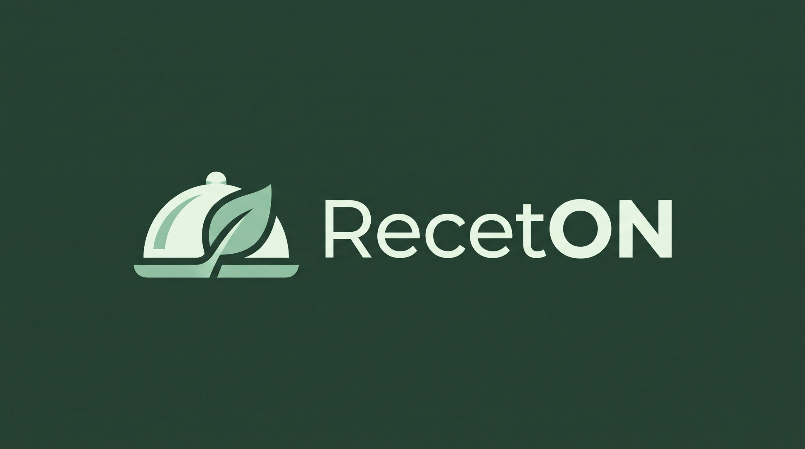
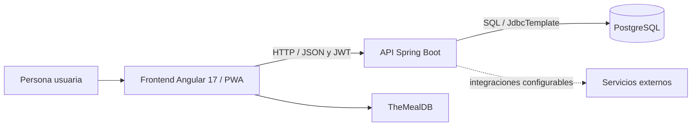

# RecetON

<p align="center">
  
</p>

<p align="center"><strong>Sabores que conectan</strong><br>Aplicación web de recetas con experiencia multiplataforma y capacidades PWA.</p>

RecetON es un proyecto académico que reúne la consulta y organización de recetas, funciones personales y una sección de productos con carrito y pedidos. La interfaz está desarrollada con Angular y se comunica con una API construida con Spring Boot, que utiliza PostgreSQL para la persistencia de datos.

## Funcionalidades principales

- Interfaces adaptables para teléfono, tableta, televisión y una vista compacta para reloj.
- Inicio de sesión y autorización mediante OAuth 2.0 Authorization Code con PKCE y tokens JWT.
- Consulta de recetas, categorías, ingredientes, pasos de preparación, imágenes e información complementaria.
- Consulta de recetas externas mediante TheMealDB.
- Favoritos y valoraciones asociados a la cuenta.
- Productos, carrito, direcciones, métodos de pago y pedidos.
- Panel de administración según el rol.
- Apartado de privacidad y solicitudes relacionadas con derechos ARCO.
- PWA con manifiesto, iconos y caché de recursos estáticos.

> **Modo sin conexión:** la PWA puede conservar la estructura de la interfaz y recursos estáticos previamente almacenados. El inicio de sesión, las operaciones de API, los datos de PostgreSQL y las integraciones externas requieren conexión y servicios disponibles.

## Tecnologías

| Área | Tecnología | Uso |
|---|---|---|
| Frontend | Angular 17, TypeScript, HTML y CSS | Interfaz, componentes, navegación y adaptación a dispositivos. |
| Backend | Java 17, Spring Boot y Gradle Wrapper | API, reglas de negocio, autenticación y autorización. |
| Base de datos | PostgreSQL | Persistencia de usuarios, recetas, productos, carritos y pedidos. |
| Acceso a datos | JdbcTemplate | Consultas SQL desde el backend. |
| Seguridad | OAuth 2.0, PKCE y JWT | Autenticación y protección de solicitudes. |
| PWA | Web App Manifest y Service Worker | Instalación compatible y caché de recursos estáticos. |
| Integraciones | TheMealDB, Gemini API y PayPal Sandbox | Servicios externos contemplados por el proyecto; requieren configuración independiente. |
| Pruebas | Postman | Verificación de endpoints y autenticación. |

## Arquitectura



El frontend no se conecta directamente a PostgreSQL. Las operaciones de datos pasan por el backend, donde se aplican las validaciones y permisos correspondientes.

## Estructura del repositorio

```text
RecetON/
├── backend/             # API Spring Boot, scripts y SQL
├── recetas-angular/     # Aplicación Angular y configuración PWA
├── documentacion/       # Auditorías, notas técnicas y configuración de demostración
├── pruebas-postman/     # Colección y material de pruebas, sin entorno local
├── .gitignore
└── README.md
```

## Requisitos de desarrollo

- Git.
- Java JDK 17.
- Node.js y npm, en versiones compatibles con Angular 17.
- PostgreSQL.
- Un navegador moderno.

El backend incluye Gradle Wrapper; se recomienda utilizar los scripts incluidos.

## Ejecución local

Los siguientes pasos describen la secuencia general. Las variables de entorno, las credenciales de PostgreSQL, el almacén de claves JWT y las URL de OAuth deben configurarse localmente. **No se incluyen secretos en este repositorio.**

### 1. Preparar PostgreSQL

1. Instalar e iniciar PostgreSQL.
2. Crear/configurar la base de datos de desarrollo `form_recetas`.
3. Revisar los scripts SQL de `backend/sql/` y aplicar únicamente los necesarios para una instalación nueva o una migración controlada.
4. Configurar las credenciales mediante el mecanismo local previsto por el backend.

No ejecutes scripts de creación o migración a ciegas sobre una base que ya contenga datos. Conserva un respaldo antes de modificar una base existente.

### 2. Preparar e iniciar el backend

Desde PowerShell:

```powershell
cd backend
.\gradlew.bat test
.\scripts\iniciar-backend-seguro.ps1
```

El inicio requiere la configuración local de PostgreSQL y del almacén de claves JWT. Consulta los scripts y la documentación del backend antes de ejecutarlo.

### 3. Preparar e iniciar Angular

En otra terminal:

```powershell
cd recetas-angular
npm install
npm start
```

La aplicación de desarrollo utiliza el proxy y la configuración de entorno correspondientes al equipo.

### 4. Compilar y servir la PWA

```powershell
cd recetas-angular
npm run build:pwa
npm run start:pwa
```

## Pruebas de API

La carpeta `pruebas-postman/` contiene una colección de Postman y material auxiliar para revisar endpoints y autenticación. El archivo de entorno local se excluye intencionalmente porque puede guardar direcciones privadas, tokens o credenciales. Configura tus propias variables en Postman y no exportes valores secretos.

## Seguridad y configuración

- No se versionan almacenes de claves, contraseñas, tokens, cookies ni archivos `.env`.
- La carpeta `backend/secrets/` y los formatos de keystore están excluidos mediante `.gitignore`.
- No publiques respaldos de PostgreSQL ni datos personales de usuarios.
- No incluyas claves reales de servicios externos; configura tus propias credenciales fuera del repositorio.
- PostgreSQL no debe exponerse directamente a Internet; el acceso de la aplicación se realiza mediante el backend.
- La publicación de demostración mediante ngrok es temporal y depende de que el equipo servidor y el túnel estén encendidos. No representa un hosting permanente.

## Documentación

La carpeta `documentacion/` reúne notas técnicas, auditorías e instrucciones de red y demostración. Los manuales del proyecto, de usuario y de identidad de marca pueden añadirse en `documentacion/manuales/` cuando se incorporen sus versiones finales.

## Equipo

Proyecto académico desarrollado por:

- José Olaf Ibarra García

## Estado del proyecto

Versión académica integrada y probada en el entorno de desarrollo del equipo. Su ejecución en otro equipo requiere configurar PostgreSQL, variables de entorno, claves de OAuth/JWT e integraciones externas.

---

**RecetON · Sabores que conectan**
